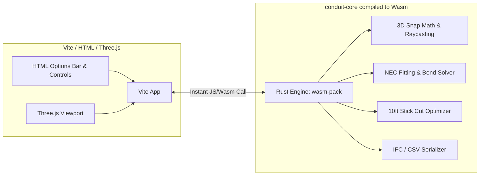

# Multi-Agent Workflow, Branch Planning & Technology Evaluation

This document captures the conversations, architectural decisions, Git branch setups, and technical feasibility evaluations recorded during the planning of the **Revit-Style Conduit Pipe Drawing System**.

---

## Conversation 1: Branch Topology Assessment

### User Prompt
> *"ok. how many bracnches do we have here?"*

### Response & Analysis
An audit of the repository showed two categories of branches:

#### 1. Existing Git Branches
* `* codex/ifc-routing` (Local active branch with the conduit takeoff viewer baseline)
* `main` (Local primary branch)
* `origin/main` (Remote upstream)
* `origin/codex/ifc-routing` (Remote feature tracking)
* `origin/codex/batch-tagging-workbench` (Remote batch tagging module)

#### 2. Architecture Plan: 5 Independent Parallel Feature Branches
To allow multiple AI agents to work simultaneously without file locks or merge conflicts, the Revit conduit drawing feature was decomposed into 5 modular branches:

| # | Branch Name | Responsibility | Isolated Files Owned |
| :- | :--- | :--- | :--- |
| **1** | `feature/revit-snap-engine` | **Snap & Polar Alignment:** Endpoints, 45°/90° polar tracking, workplane raycast | `packages/conduit-core/src/snap-engine.js`<br>`packages/conduit-core/test/snap-engine.test.js` |
| **2** | `feature/revit-fitting-solver` | **NEC Bends & Auto-Elbows:** Standard bend radii, arc generation, 360° bend rule | `packages/conduit-core/src/fitting-solver.js`<br>`packages/conduit-core/test/fitting-solver.test.js` |
| **3** | `feature/revit-viewport-controls` | **Navisworks View Controls & Picking:** Decoupled orbit/pan, surface click filtering (fixing IFC element selection conflict) | `conduit-takeoff/src/viewport-controls.js`<br>`conduit-takeoff/src/surface-picker.js` |
| **4** | `feature/revit-mep-hud` | **Live HUD & Properties:** Floating length/angle badges, direct numeric typing, properties inspector | `conduit-takeoff/src/mep-hud.js`<br>`conduit-takeoff/src/properties-panel.js` |
| **5** | `feature/revit-bom-export` | **BOM & Stick Optimizer:** 10ft stick bin-packing, coupling/fitting schedule, IFC4 export | `packages/conduit-core/src/bom-calculator.js`<br>`packages/conduit-core/test/bom-calculator.test.js` |
| **—** | `integration/revit-conduit` | **Integration Staging:** Integration branch to merge all components | `conduit-takeoff/src/drawing-tool.js` |

---

## Conversation 2: Branching Strategy Off `codex/ifc-routing`

### User Prompt
> *"It is possible to create this new branches out of \* codex/ifc-routing for agents to work there?"*

### Response & Analysis
**Yes.** All feature branches should originate from `codex/ifc-routing` so every agent inherits the conduit takeoff viewer, Three.js engine setup, coordinate transformation utilities, and test suites.

**Prerequisite:** Because uncommitted changes were active in `codex/ifc-routing`, Git would not propagate untracked files (such as `conduit-takeoff/`) to new branches. A clean baseline commit was required before branching.

---

## Conversation 3: Creating Branches & Preparation for Work

### User Prompts
> *"ok. Only create the branches for now. Sort anything you need but do not work on the conduit feature yet"*
>
> *"ok. what else do we need to start working?"*

### Execution & Response
1. **Committed Baseline (`d86ab22`):**
   * Staged and committed 20 files (+4,168 lines) containing the complete conduit takeoff viewer app and new core modules.
   * All 67 automated test cases passing.
2. **Created Feature Branches:**
   * `feature/revit-snap-engine`
   * `feature/revit-fitting-solver`
   * `feature/revit-viewport-controls`
   * `feature/revit-mep-hud`
   * `feature/revit-bom-export`
   * `integration/revit-conduit`
3. **Operational Setup Options for Parallel Execution:**
   * **Option A (Git Worktrees):** Run `git worktree add ../<dir> <branch>` to create isolated physical directories for agents running concurrently.
   * **Option B (Sequential):** Work branch-by-branch in the single workspace using `git checkout`.

---

## Conversation 4: Merging Baseline into Main, GitHub Push & Agent Prompts

### User Prompt
> *"OK. MAKE A COMMIT OF THIS WHOLE REPOSITORY TO GITHUB IN THE MAIN BRANCH. THEN i WILL RUN feature/revit-viewport-controls AND feature/revit-snap-engine FROM CRUSOR AAND GEMINI."*

### Execution & Details
1. **Merged `codex/ifc-routing` into `main`:**
   * Resolved merge conflict in `src/main.js` by retaining federated IFC element selection and pointer-down overlay shields.
   * Created merge commit `cf0a947`. Verified all 67 tests passing.
2. **Pushed to GitHub (`origin`):**
   * `main` pushed to `origin/main`.
   * Aligned all feature branches to `cf0a947` and pushed them to remote origin.
3. **Agent Launch Prompts:**

#### Cursor Prompt (`feature/revit-viewport-controls`)
```markdown
You are working on branch `feature/revit-viewport-controls`.

Task:
1. Decouple 3D viewport navigation from drawing tools:
   - Allow Navisworks-style Right-Click Orbit and Middle-Click Pan without losing or cancelling the active conduit rubberband line.
2. Fix the surface-click selection conflict:
   - When drawing or in "Pick Elevation" mode, clicking an IFC surface to sample height or place a conduit point must NOT trigger the IFC element selection highlighter.

Files to edit:
- conduit-takeoff/src/drawing-tool.js
- conduit-takeoff/src/viewport-controls.js (if creating a modular helper)

Constraint:
Do not touch snap math or fitting logic in packages/conduit-core. Run `npm test` to ensure tests remain passing.
```

#### Gemini Prompt (`feature/revit-snap-engine`)
```markdown
You are working on branch `feature/revit-snap-engine`.

Task:
1. Implement pure mathematical snapping & polar alignment:
   - Endpoint & centerline snapping to existing conduit nodes within a distance threshold.
   - Polar angle tracking (0°, 45°, 90°, 135°) relative to the previous point.
   - Workplane raycast fallback for steep camera angles so the line doesn't disappear.
2. Add comprehensive unit tests.

Files to edit:
- packages/conduit-core/src/snap-engine.js
- packages/conduit-core/test/snap-engine.test.js

Constraint:
Keep this pure JavaScript math with zero Three.js DOM dependencies. All tests must run and pass under `npm test`.
```

---

## Conversation 5: Technical Feasibility Evaluation (Python vs. C++ vs. Rust)

### User Prompts
> *"RANDOM QUESTION: HOW DIFFICULT WILL BE TTO TURN ALL THIS PYTHON CODE INTO RUST? BRIEF ANSWER"*
>
> *"It would be possible to just focus on using C++only for the whole conduit branch?"*
>
> *"my fauilt. it was rust not c++"*

### Technical Assessment

#### 1. Porting Existing Python Code to Rust
* **Difficulty:** **6.5 / 10 (Moderate to High)**
* **Network & Excel Services (3/10):** HTTP/WebSocket endpoints (using `Axum`) and Excel reading (using `calamine`) are straightforward in Rust.
* **IFC Geometry & Graph Traversal (8/10):** Python's `ifcopenshell` ecosystem is more mature than pure-Rust IFC options. A port would either require C++ FFI bindings or custom STEP parsers.
* **Benefits:** 10x–50x execution speedup in graph analysis and the ability to compile directly to WebAssembly (Wasm), eliminating the local Python daemon.

#### 2. Using Rust for the Conduit Branch
Rust is vastly superior to C++ for web-based CAD applications because of its first-class WebAssembly ecosystem (`wasm-pack` + `wasm-bindgen`).



#### Key Advantages of Rust in `conduit-core`:
1. **Vite Integration:** Easily imported as an npm package via `vite-plugin-wasm` with auto-generated TypeScript declarations (`.d.ts`).
2. **Zero Garbage Collection Stutters:** Guarantees 60–120 FPS continuous snapping without JavaScript memory collector pauses.
3. **Compile-Time Safety:** Prevents vector math and null/undefined coordinate exceptions.

#### Recommended Architecture:
* **Core Computational Engine:** Rust compiled to WebAssembly (`conduit-engine.wasm`).
* **Viewport & User Interface:** Three.js and HTML/CSS inside Vite.
